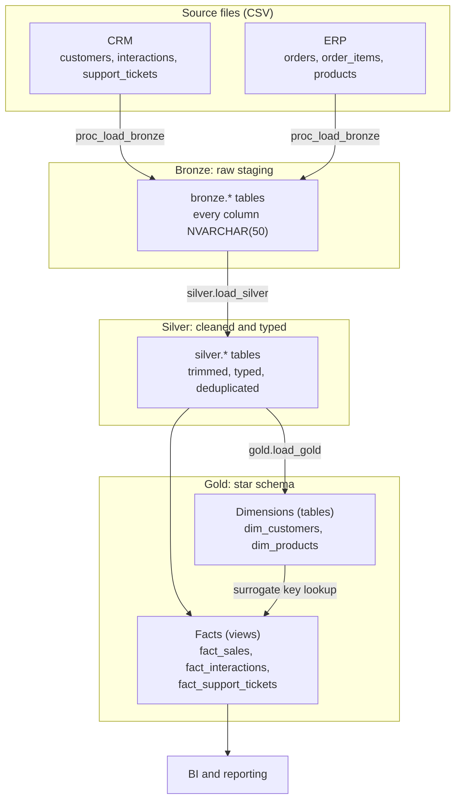
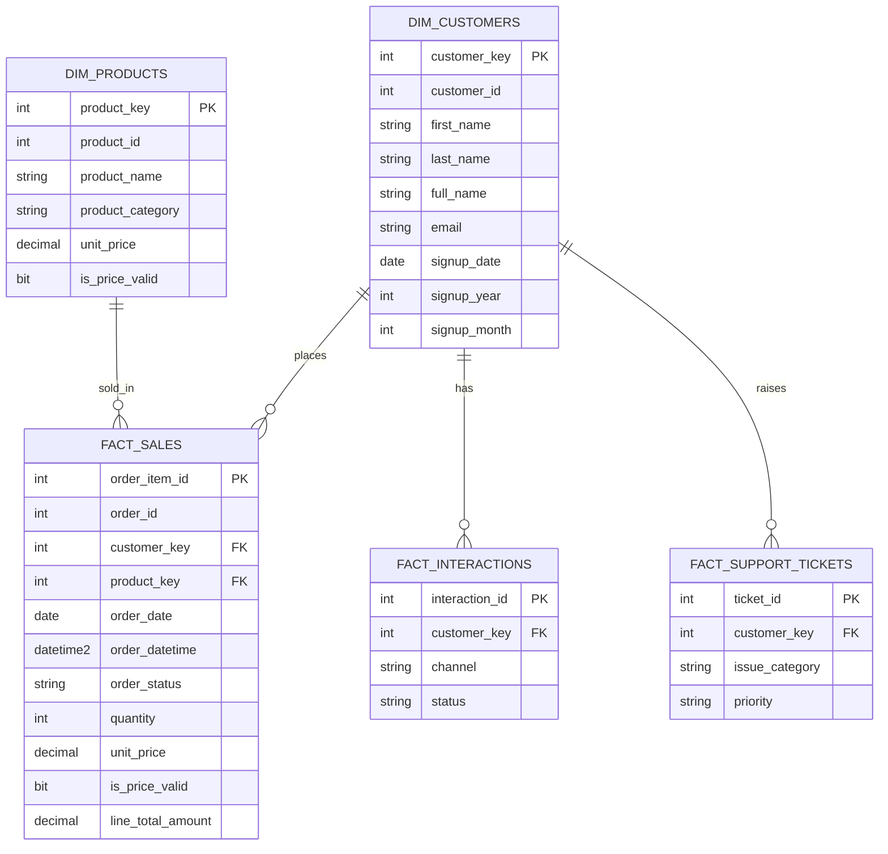

# SQL Data Warehouse Project

An end-to-end data warehouse built in **SQL Server** using the **Medallion Architecture** (Bronze → Silver → Gold). It ingests raw CRM and ERP CSV files (about 2 million source rows), cleans, deduplicates and types them, and publishes a **star schema** with stable surrogate keys, ready for BI and reporting.

## Highlights

- **Three-layer Medallion design** with a clear responsibility for each layer: raw staging, cleaning, and business-ready modeling.
- **Resilient ingestion:** bronze stores everything as text, so a bad value never breaks a bulk load.
- **Data cleaning in T-SQL:** safe type casting, standardized values, and deterministic deduplication on six tables.
- **Honest handling of bad data:** invalid prices stay `NULL` and are flagged, instead of being replaced with fake values.
- **Stable surrogate keys:** dimensions are stored tables with `IDENTITY` keys, loaded incrementally so keys never shift between loads.
- **Unknown members (key −1):** facts that reference missing customers or products still join and still count.
- **Built-in quality checks:** a validation script covers key integrity, orphan records, Silver-to-Gold reconciliation, and value hygiene.
- **Error handling:** load procedures log durations, run Gold in a transaction, and re-raise failures.

## Architecture



### Data sources

| System | Files | Approx. rows |
|--------|-------|--------------|
| CRM | `customers` | 200,000 |
| CRM | `interactions` | 500,000 |
| CRM | `support_tickets` | 350,000 |
| ERP | `orders` | 350,000 |
| ERP | `order_items` | 650,000 |
| ERP | `products` | 50,000 |

## Layers

### Bronze (`bronze.*`)

Raw staging layer. Every column is loaded as `NVARCHAR(50)` so bulk loads never fail on type, decimal, or date conversion errors. No transformation happens here, so the layer is an exact copy of the source files.

### Silver (`silver.*`)

Cleaned and typed tables, loaded from bronze by `silver.load_silver`. Each run is a **full refresh**: tables are truncated and reloaded, and the procedure prints the duration of every step.

**Standard transformations**

- Trim and standardize strings (emails lowercased, statuses and categories normalized)
- Cast raw text with `TRY_CAST` / `TRY_CONVERT`: IDs and quantities to `INT` (through `DECIMAL`, so a value like `"3.0"` converts cleanly), prices to `DECIMAL(18,2)`, dates to `DATETIME2`
- Add an audit column, `dwh_create_date`, to every table

**Business rules**

| Rule | Applies to |
|------|-----------|
| Keep **one row per business key**, choosing the most complete row and breaking ties in a fixed order so every run gives the same result | all six tables |
| Customers: keep the record with the **latest `signup_date`** | `crm_customers` |
| Orders: prefer a row with a valid date, then the latest date | `erp_orders` |
| Products: prefer a row with a valid price | `erp_products` |
| Drop rows whose key cannot be converted to a number | all tables, on their own ID; also `customer_id` on `crm_customers` and `erp_orders` |
| Set missing or non-positive prices to **`NULL`** and flag them with `is_price_valid = 0` | `erp_products` |
| Map `Cancelled` and `Canceled` to a single value, `Cancelled` | `erp_orders` |
| Default blank values: `unknown` (interaction status), `Uncategorized` (ticket category), `Unknown` (order status), `Unnamed Product` | various |
| Default quantities that are missing or ≤ 0 to `1` | `erp_order_items` |

**Tables**

| Table | Columns |
|-------|---------|
| `silver.crm_customers` | `customer_id`, `first_name`, `last_name`, `email`, `signup_date` |
| `silver.crm_interactions` | `interaction_id`, `customer_id`, `channel`, `status` |
| `silver.crm_support_tickets` | `tickets_id`, `customer_id`, `issue_category`, `priority` |
| `silver.erp_orders` | `order_id`, `customer_id`, `order_date`, `order_status` |
| `silver.erp_order_items` | `order_item_id`, `order_id`, `product_id`, `quantity` |
| `silver.erp_products` | `product_id`, `product_name`, `category`, `price`, `is_price_valid` |

### Gold (`gold.*`)

Business-ready star schema. **Dimensions are stored tables** with stable surrogate keys. **Facts are views** that look those keys up.

| Object | Type | Grain | Key logic |
|--------|------|-------|-----------|
| `gold.dim_customers` | Dimension (table) | One row per customer | `IDENTITY` surrogate key `customer_key`; `UNIQUE` on `customer_id`; builds `full_name`; splits `signup_date` into date, year, month; Type 1 updates |
| `gold.dim_products` | Dimension (table) | One row per product | `IDENTITY` surrogate key `product_key`; `UNIQUE` on `product_id`; fills blank categories with `uncategorized`; carries `unit_price` and `is_price_valid`; Type 1 updates |
| `gold.fact_sales` | Fact (view) | One row per order line | Looks up `customer_key` and `product_key`; calculates `line_total_amount = quantity × unit_price` |
| `gold.fact_interactions` | Fact (view) | One row per interaction | Looks up `customer_key`; channel and status |
| `gold.fact_support_tickets` | Fact (view) | One row per ticket | Looks up `customer_key`; renames `tickets_id` to `ticket_id`; issue category and priority |

**How the dimensions load (`gold.load_gold`)**

- Never truncates, so existing surrogate keys never change.
- Existing business IDs have their attributes updated in place, but only when something actually changed.
- New business IDs are inserted and receive the next key.
- Runs inside a transaction; any failure rolls back and is re-raised.

**Unknown members.** Each dimension contains a row with key `-1` named "Unknown". Facts that reference a customer or product missing from the dimensions point at `-1` instead of holding `NULL` keys, so every fact row still joins and totals stay complete. For that reason the dimension row counts are the real row counts plus one (200,001 customers and 50,001 products).

## Data Model



## Data Quality

`Tests/quality_checks.sql` validates the warehouse after every load. Checks marked *expect 0* should return zero; *informational* checks report data quality rather than failures.

| Area | What it verifies |
|------|------------------|
| **Silver keys** | No null or duplicate business keys in any silver table |
| **Price flags** | `price` and `is_price_valid` agree; no non-positive prices remain |
| **Silver orphans** | Order items without an order or product; orders, interactions and tickets without a customer *(informational, see below)* |
| **Reconciliation** | `silver.erp_order_items` row count equals `gold.fact_sales`, so no order lines are lost or duplicated by the joins |
| **Dimension integrity** | Rows equal distinct keys and distinct business IDs; exactly one Unknown member; row count equals silver plus one |
| **Dimension completeness** | No silver customer or product is missing from its dimension |
| **Fact-to-dimension links** | Counts fact rows that fall back to the Unknown member |
| **Revenue impact** | Share of order lines excluded from revenue because of an invalid price |
| **Value hygiene** | Distinct values per categorical column, to catch casing issues and typos |

### Data quality findings

Issues found in the source data and how the pipeline handles them:

| Finding | Handling |
|---------|----------|
| Duplicate business keys in **5 tables**: 4 products, 5 orders, 6 order items, 7 interactions, 5 tickets (27 rows) | Removed in silver with deterministic `ROW_NUMBER()` rules |
| 9 products with a missing or non-positive price | Price set to `NULL`, `is_price_valid = 0`; the lines are excluded from revenue instead of being counted as zero |
| `Cancelled` and `Canceled` both used as an order status | Standardized to `Cancelled` |
| About 1,750 orders, 2,547 interactions and 1,712 tickets reference customers missing from the CRM file | Kept, and assigned to the Unknown customer (`-1`) |
| 13 orders with an unparseable date | Kept with a `NULL` date; they count in totals but not in time-based analysis |

**Verified results:** silver and gold both contain 650,000 order lines (equal), the dimensions hold 200,000 customers and 50,000 products plus one Unknown member each, and no silver customer or product is missing from its dimension.

## Example Queries

These run on the gold layer.

```sql
-- Revenue by product category (excludes cancelled orders)
SELECT p.product_category,
       SUM(f.line_total_amount) AS revenue
FROM gold.fact_sales f
JOIN gold.dim_products p ON f.product_key = p.product_key
WHERE f.order_status <> 'Cancelled'
GROUP BY p.product_category
ORDER BY revenue DESC;

-- Monthly revenue trend
SELECT YEAR(order_date)  AS order_year,
       MONTH(order_date) AS order_month,
       SUM(line_total_amount) AS revenue
FROM gold.fact_sales
WHERE order_date IS NOT NULL
  AND order_status <> 'Cancelled'
GROUP BY YEAR(order_date), MONTH(order_date)
ORDER BY order_year, order_month;

-- Top 10 customers by revenue (known customers only)
SELECT TOP 10 c.full_name,
       SUM(f.line_total_amount) AS revenue
FROM gold.fact_sales f
JOIN gold.dim_customers c ON f.customer_key = c.customer_key
WHERE c.customer_key <> -1
GROUP BY c.full_name
ORDER BY revenue DESC;
```

## Repository Structure

```text
SQL-Data-Warehouse-Project/
├── README.md
├── Scripts/
│   ├── Bronze/
│   │   ├── ddl_bronze.sql           # Creates bronze tables
│   │   └── proc_load_bronze.sql     # Bulk loads the CSV files into bronze
│   ├── Silver/
│   │   ├── ddl_silver.sql           # Creates silver tables
│   │   └── proc_load_silver.sql     # silver.load_silver: clean, cast, deduplicate
│   └── Gold/
│       ├── ddl_gold.sql             # Dimension tables, Unknown members, fact views
│       └── proc_load_gold.sql       # gold.load_gold: load and update dimensions
├── Tests/
│   └── quality_checks.sql           # Validation checks for silver and gold
└── Docs/                            # Diagrams and documentation
```

## Getting Started

### Prerequisites

- SQL Server 2016 SP1 or later (uses `CREATE OR ALTER`, `TRY_CAST`, `THROW`)
- SQL Server Management Studio (SSMS) or a compatible client
- The six source CSV files, and permission to run `BULK INSERT` on them

### Run order

1. Create the `Datawarehouse` database and the `bronze`, `silver`, and `gold` schemas.
2. **Bronze:** run `ddl_bronze.sql`, then `proc_load_bronze.sql`. Update the CSV file paths in the procedure first, then execute it.
3. **Silver:** run `ddl_silver.sql` and `proc_load_silver.sql`, then:
   ```sql
   EXEC silver.load_silver;
   ```
4. **Gold:** run `ddl_gold.sql` and `proc_load_gold.sql`, then:
   ```sql
   EXEC gold.load_gold;
   ```
5. **Validate:** run `Tests/quality_checks.sql`.

> **Important:** `ddl_silver.sql` drops and recreates the silver tables, which empties them. Always run `silver.load_silver` and then `gold.load_gold` afterwards, and run `gold.load_gold` after **every** silver load so the dimensions stay current. `ddl_gold.sql` is safe to re-run: it keeps existing dimension data and surrogate keys.

## Key Design Decisions

- **Why `NVARCHAR` in bronze?** Ingestion stays resilient. Bad values land in the table and are handled in silver instead of crashing the load.
- **Why `TRY_CAST` in silver?** Invalid values become `NULL` instead of failing the whole procedure.
- **Why `NULL` and a flag instead of `0.00` for bad prices?** Zero looks like a real price and silently understates revenue. `NULL` keeps the problem visible, and `is_price_valid` lets analysts filter or investigate it.
- **Why deduplicate in silver?** Silver is the layer that guarantees unique keys. Duplicate orders would otherwise multiply their order lines in `fact_sales` and overstate revenue.
- **Why truncate and reload silver?** The datasets are small enough that a full refresh keeps the load simple and repeatable.
- **Why store dimensions as tables?** Surrogate keys generated with `ROW_NUMBER()` in a view change whenever records are added, which breaks joins and BI models. Stored `IDENTITY` keys stay stable.
- **Why Unknown members?** Source data contains references to customers that don't exist. A `-1` row keeps those facts joinable and visible instead of dropping them or leaving `NULL` keys.
- **Why views for facts?** They always reflect the latest silver and dimension data and need no extra load step.
- **Why no primary keys in silver?** Uniqueness is enforced by the load logic and verified by the quality checks.

## Known Limitations

- **Type 1 dimensions.** Changes overwrite old values and history is not kept.
- **Current prices only.** Order items have no price at time of sale, so `line_total_amount` uses the product's current price, and historical revenue changes if prices change.
- **Invalid prices are excluded from revenue.** Lines for the products flagged with `is_price_valid = 0` have a `NULL` `line_total_amount`, so revenue is understated by those lines. The quality checks report how many.
- **Quantity defaults to `1`.** Missing or non-positive quantities are replaced, which is an assumption and not a source value.
- **Missing customers.** A small share of orders, interactions and tickets belong to the Unknown customer because the CRM file has no matching record.
- **No dates on interactions and tickets**, so they can't be analyzed over time.
- **Some orders have no date** (unparseable in the source) and are excluded from time-based analysis.
- **Conflicting duplicates are resolved by rule.** When duplicate rows disagree, the pipeline keeps the most complete row with a fixed tie-break, which may not always match the business's view of the correct one.
- **Full refresh only.** There is no incremental loading or change tracking in bronze and silver.
- **Fact views are not materialized.** This is fine at this size, but very large volumes would call for stored fact tables.
- **Naming.** Silver uses `tickets_id`; gold exposes `ticket_id`.

## Future Improvements

- Slowly changing dimensions (Type 2) to keep customer and product history
- Incremental loads and change tracking
- Store the price on the order line, or track price history in the product dimension
- Materialized fact tables with indexes for larger volumes
- A load audit table that records row counts and status for every run
- Orchestration (SQL Server Agent or similar) and automated test runs

## Author

**Olayemi Ajayie**
[LinkedIn](#) · [GitHub](#)
