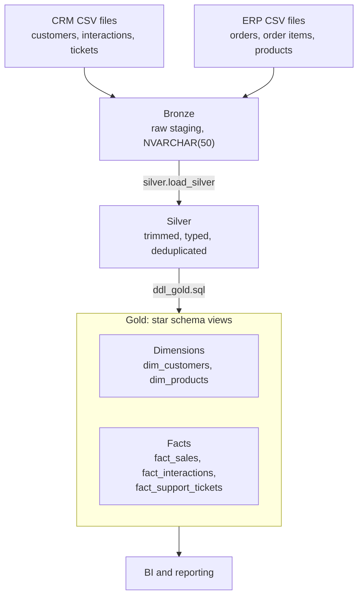
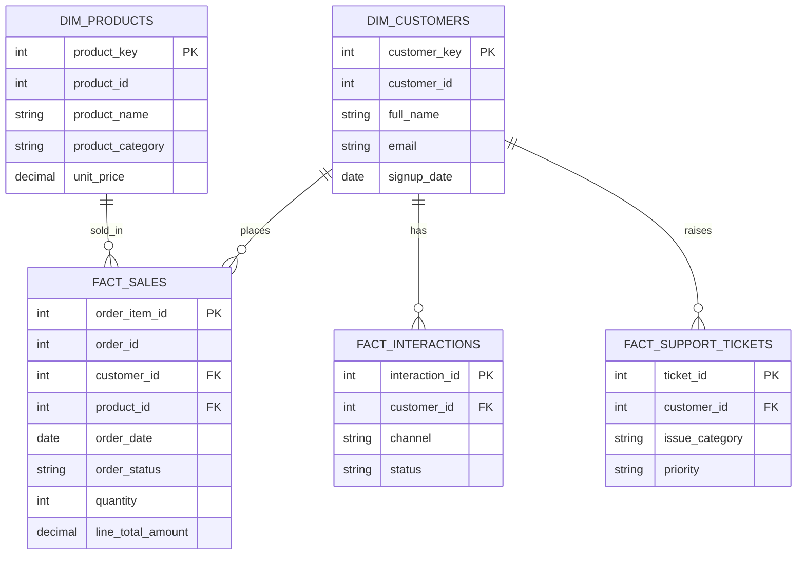

# SQL Data Warehouse Project

An end-to-end data warehouse built in **SQL Server** using the **Medallion Architecture** (Bronze → Silver → Gold). It ingests raw CRM and ERP CSV files, cleans and types the data, and exposes a star schema ready for BI and reporting.

## Architecture



### Data sources

| System | Files |
|--------|-------|
| CRM | `customers`, `interactions`, `support_tickets` |
| ERP | `orders`, `order_items`, `products` |

## Layers

### Bronze (`bronze.*`)

Raw staging layer. Every column is loaded as `NVARCHAR(50)` so bulk loads never fail on type, decimal, or date conversion errors. No transformation happens here.

### Silver (`silver.*`)

Cleaned, typed tables loaded from bronze by the `silver.load_silver` stored procedure. Each run is a **full refresh**: every table is truncated and reloaded, and the procedure logs the duration of each step.

**Transformations**

- Trims and standardizes strings, statuses, and categories
- Casts raw text with `TRY_CAST` / `TRY_CONVERT`: IDs and quantities to `INT` (via `DECIMAL`, so values like `"3.0"` convert cleanly), prices to `DECIMAL(18,2)`, dates to `DATETIME2`
- Adds an audit column, `dwh_create_date`, to every table

**Business rules**

| Rule | Applies to |
|------|-----------|
| Keep only the latest record per customer (`ROW_NUMBER()` ordered by `signup_date` descending) | `crm_customers` |
| Drop rows whose `customer_id` cannot be converted to a number | `crm_customers`, `erp_orders` |
| Default missing or blank values to `unknown`, `Uncategorized`, `Unknown`, or `Unnamed Product` | statuses, categories, product names |
| Standardize order status values (`COMPLETED` → `Completed`, etc.) | `erp_orders` |
| Default quantities that are missing or ≤ 0 to `1` | `erp_order_items` |
| Default prices that are missing or ≤ 0 to `0.00` | `erp_products` |

**Tables**

| Table | Columns |
|-------|---------|
| `silver.crm_customers` | `customer_id`, `first_name`, `last_name`, `email`, `signup_date` |
| `silver.crm_interactions` | `interaction_id`, `customer_id`, `channel`, `status` |
| `silver.crm_support_tickets` | `tickets_id`, `customer_id`, `issue_category`, `priority` |
| `silver.erp_orders` | `order_id`, `customer_id`, `order_date`, `order_status` |
| `silver.erp_order_items` | `order_item_id`, `order_id`, `product_id`, `quantity` |
| `silver.erp_products` | `product_id`, `product_name`, `category`, `price` |

### Gold (`gold.*`)

Business-ready star schema, built as views on top of silver.

| View | Type | Grain | Key logic |
|------|------|-------|-----------|
| `gold.dim_customers` | Dimension | One row per customer | Generates `customer_key` with `ROW_NUMBER()`; builds `full_name`; splits `signup_date` into date, year, and month |
| `gold.dim_products` | Dimension | One row per product | Generates `product_key`; fills blank categories with `uncategorized`; renames `price` to `unit_price` |
| `gold.fact_sales` | Fact | One row per order line | Joins order items to orders and products; calculates `line_total_amount = quantity × unit_price` |
| `gold.fact_interactions` | Fact | One row per interaction | Customer interactions by channel and status |
| `gold.fact_support_tickets` | Fact | One row per ticket | Renames `tickets_id` to `ticket_id`; tickets by issue category and priority |

## Data Model



## Data Quality & Reconciliation Checks

`Scripts/Gold/quality_checks_gold.sql` validates the gold layer before it is used for reporting:

| Check | What it verifies |
|-------|------------------|
| **Row reconciliation** | `silver.erp_order_items` row count matches `gold.fact_sales`, so no order lines are lost or duplicated by the joins. Also returns total revenue for a sanity check. |
| **Dimension key uniqueness** | In `gold.dim_customers` and `gold.dim_products`, total rows equal distinct surrogate keys and distinct business IDs. |
| **Category and priority hygiene** | Lists distinct values and counts for `product_category`, `issue_category`, and `priority` to catch casing issues and typos (e.g. `Biling`) that slipped through silver cleaning. |

**Results:** *(Add one line, e.g. "Silver and gold row counts match at X rows; found and fixed N inconsistent category values.")*

## Repository Structure

```text
SQL-Data-Warehouse-Project/
├── README.md
├── Scripts/
│   ├── Bronze/
│   │   ├── ddl_bronze.sql           # Creates bronze tables
│   │   └── proc_load_bronze.sql     # Bulk loads CSVs into bronze
│   ├── Silver/
│   │   ├── ddl_silver.sql           # Creates silver tables
│   │   └── proc_load_silver.sql     # Creates silver.load_silver (bronze → silver)
│   └── Gold/
│       ├── ddl_gold.sql             # Creates star-schema views
│       └── quality_checks_gold.sql  # Reconciliation and hygiene checks
└── Docs/                            # Diagrams and documentation
```

## How to Run

1. Create the `Datawarehouse` database and the `bronze`, `silver`, and `gold` schemas.
2. Run `Scripts/Bronze/ddl_bronze.sql`, then `proc_load_bronze.sql`.
3. Update the CSV file paths in the bronze load procedure to match your machine, then execute it.
4. Run `Scripts/Silver/ddl_silver.sql` and `proc_load_silver.sql`, then `EXEC silver.load_silver;`
5. Run `Scripts/Gold/ddl_gold.sql` to create the views.
6. Run `Scripts/Gold/quality_checks_gold.sql` to validate the results.

## Key Design Decisions

- **Why NVARCHAR in bronze?** It keeps ingestion resilient. Bad values land in the table and get handled in silver instead of crashing the load.
- **Why TRY_CAST in silver?** Invalid values become `NULL` instead of failing the whole procedure.
- **Why truncate and reload?** The datasets are small and a full refresh keeps the load simple and repeatable.
- **Why views in gold?** The star schema always reflects the latest silver data with no extra load step.
- **Why no primary keys in silver?** Uniqueness is enforced in the load logic and verified by the gold quality checks.

## Known Limitations

- **Surrogate keys are generated in views.** `customer_key` and `product_key` come from `ROW_NUMBER()`, so they can shift when new records are added. A production design would store them in tables.
- **Facts join to dimensions on business IDs** (`customer_id`, `product_id`) rather than surrogate keys.
- **Prices are current prices.** Order items don't store the price at time of sale, so `line_total_amount` uses the product's current price and historical revenue changes if prices change.
- **Bad prices produce zero revenue.** Silver defaults missing or non-positive prices to `0.00`, so those order lines contribute nothing to `line_total_amount`.
- **Interaction and ticket facts have no date column**, so they can't be analyzed over time.
- **Full refresh only.** There is no incremental loading or change tracking.

## Tech Stack

- SQL Server (T-SQL, stored procedures, views)
- SQL Server Management Studio (SSMS)
- CSV flat files as the source

## Author

**Olayemi Ajayi** – [LinkedIn](#) · [GitHub](#)
